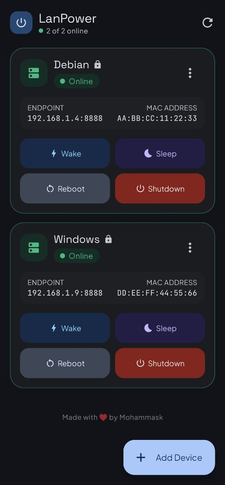
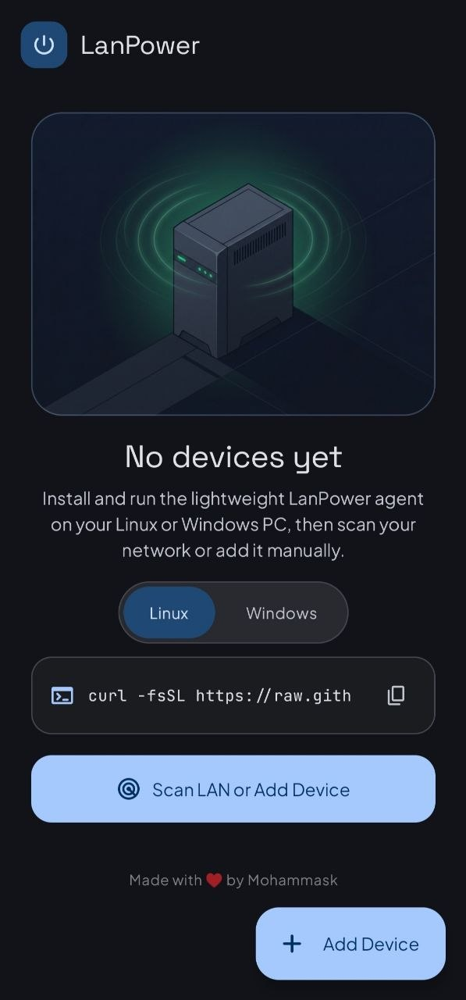

<p align="center">
  
</p>

<h1 align="center">LanPower</h1>

<p align="center">
  <strong>Lightweight local power controller for Linux &amp; Windows — paired with a Material 3 Android app.</strong><br />
  Wake, Sleep, Reboot, and Shut down machines across your LAN with a single tap, using only native OS tools and zero third-party agent packages.
</p>

<p align="center">
  
  
  
  
</p>

<p align="center">
  <a href="#screenshots">Screenshots</a> •
  <a href="#features">Features</a> •
  <a href="#quick-start">Quick Start</a> •
  <a href="#security-architecture">Security</a> •
  <a href="#api-reference">API</a> •
  <a href="#troubleshooting--faq">FAQ</a>
</p>

---

## Screenshots

<table>
  <tr>
    <th align="center" width="50%">Live LAN Dashboard</th>
    <th align="center" width="50%">Built-in Setup Guide</th>
  </tr>
  <tr>
    <td align="center" width="50%">
      
    </td>
    <td align="center" width="50%">
      
    </td>
  </tr>
</table>

---

## Features

- **Native OS Agents (No Third-Party Packages):**
  - **Linux:** Uses only Python 3.7+'s standard library and `systemd` (with optional `ethtool` for Wake-on-LAN persistence — no `pip` packages or external frameworks).
  - **Windows 10 / 11:** Pure built-in PowerShell, .NET, and Task Scheduler (no extra runtimes required).
- **Full Power Control:** Wake-on-LAN (`Magic Packet`), Sleep / Suspend, Reboot, and Shutdown.
- **Smart Interactive Installer:** Distinguishes physical vs. virtual network adapters, verifies port availability, configures persistent Wake-on-LAN (`ethtool` + NetworkManager on Linux; driver/WMI settings + Fast Startup check on Windows), and includes a clean uninstaller.
- **Material 3 Android Companion:** Built with Kotlin & Jetpack Compose featuring automatic LAN scanning, pull-to-refresh status polling, confirmation dialogs, and PIN lockout feedback.

---

## Quick Start

### 1. Install the Agent on Your PC / Server

#### Linux (Ubuntu, Debian, Fedora, Arch, openSUSE)
Requires `systemd` and `Python 3.7+` (the installer can install `python3` and optional `ethtool` via your distro's package manager). Run as `root`:
```bash
curl -fsSL https://raw.githubusercontent.com/Mohammask/LanPower/main/linux/lanpower.sh | sudo bash
```

#### Windows 10 / 11
Run in an **Administrator** PowerShell window:
```powershell
irm https://raw.githubusercontent.com/Mohammask/LanPower/main/windows/lanpower.ps1 | iex
```

> **Tip:** Feel free to inspect [`linux/lanpower.sh`](linux/lanpower.sh) and [`windows/lanpower.ps1`](windows/lanpower.ps1) directly before piping them to your shell.

Both scripts launch an interactive CLI manager where you can install the background service, set or remove a PIN, inspect live status & WoL state, or completely uninstall.

### 2. Install the Android App

Download the latest APK from **[GitHub Releases](https://github.com/Mohammask/LanPower/releases)** and install it on your Android device.

### 3. Scan & Control

Open **LanPower**, tap **Scan LAN or Add Device**, enter your PIN if configured, and manage your machines immediately.

---

## Security Architecture

LanPower is designed for safe operation on private local networks without unnecessary attack surface:

| Layer | Implementation |
| --- | --- |
| **LAN-Only Firewall** | When an active firewall is detected (UFW / `firewalld` on Linux, Windows Defender Firewall on Windows), the installer scopes rules strictly to private LAN subnets (`RFC1918`, `100.64.0.0/10`, link-local) and skips auto-opening public IP subnets. Linux rules are tracked and cleanly pruned on port change or uninstall. |
| **Constant-Time PIN Auth** | Optional `X-Auth-Token` verification using `hmac.compare_digest` (Linux) and constant-time bitwise XOR comparison (Windows). Requires 4–64 printable ASCII characters. Without a PIN, any device on the LAN can send power commands; the PIN travels in cleartext over local HTTP (see FAQ below). |
| **Brute-Force Protection** | 5 consecutive failed PIN attempts lock out the source IP for **60 seconds** (`HTTP 429` with `retry_after` in JSON) while preserving active lockouts during cleanup. |
| **Browser CSRF Protection** | `POST` requests containing a browser `Origin` header are rejected with `HTTP 403` (`browser_requests_not_allowed`), blocking malicious web pages from triggering local power actions even when no PIN is configured. |
| **Locked File Permissions** | Config files holding the PIN are written atomically with mode `0600` (directory `0700`) via environment variables on Linux, and restricted strictly to `SYSTEM` & `Administrators` via universal-SID `icacls` ACLs on Windows. On Windows, the installer also verifies the install directory is not a symlink/junction and is owned exclusively by `SYSTEM` or `Administrators`. |
| **Local Scope** | Uses lightweight local HTTP intended **strictly for trusted private LANs**. Never port-forward or expose the agent port to the public internet. |

---

## API Reference

All endpoints speak JSON. When a PIN is configured, send it in the `X-Auth-Token` HTTP header.

| Method | Endpoint | Auth | Description | Success Response (`200 OK`) |
| --- | --- | :---: | --- | --- |
| `GET` | `/status` | No | Health check, hostname, MAC, interface, and auth flag | `{"service":"lan-power-agent","version":"1.0","status":"online","hostname":"PC","mac":"AA:BB:CC:11:22:33","interface":"eth0","auth_required":true}` |
| `POST` | `/verify` | Yes | Verify PIN without triggering a power action | `{"ok":true,"authorized":true}` |
| `POST` | `/sleep` | Yes | Suspend / sleep the host (`systemctl suspend` / `SetSuspendState`, may hibernate instead of sleep on Windows if Hibernation is enabled) | `{"ok":true,"action":"sleep"}` |
| `POST` | `/reboot` | Yes | Reboot the operating system (uses `shutdown.exe /f` on Windows, forcing open apps to close) | `{"ok":true,"action":"reboot"}` |
| `POST` | `/poweroff` | Yes | Shut down the operating system (uses `shutdown.exe /f` on Windows, forcing open apps to close) | `{"ok":true,"action":"poweroff"}` |

**Error Status Codes:**
- `401 Unauthorized` — Missing or invalid `X-Auth-Token` (`{"ok":false,"error":"unauthorized"}`)
- `403 Forbidden` — Browser-originated `POST` request blocked (`{"ok":false,"error":"browser_requests_not_allowed"}`)
- `429 Too Many Requests` — IP temporarily locked after 5 failed attempts (`{"ok":false,"error":"too_many_attempts","retry_after":60}`)
- `404 Not Found` — Unknown endpoint

---

## Repository Structure

```text
LanPower/
├── linux/
│   └── lanpower.sh       # Linux installer, CLI manager & embedded Python 3 agent
├── windows/
│   └── lanpower.ps1      # Windows installer, CLI manager & embedded PowerShell agent
├── android/              # Kotlin / Jetpack Compose Android app
├── assets/               # App icon and README screenshots
└── LICENSE               # MIT License
```

### Building the Android App from Source

Requires **Android Studio** (or **JDK 17+** with the **Android SDK** configured via `ANDROID_HOME` or `android/local.properties`):

```bash
cd android
./gradlew assembleDebug        # Linux / macOS
.\gradlew.bat assembleDebug    # Windows
```

> Release builds automatically use `android/keystore.properties` if present (gitignored) and fall back cleanly for local development clones.

---

## Troubleshooting & FAQ

<details>
<summary><b>Wake-on-LAN doesn't wake my PC from full Shutdown (S5)</b></summary>

1. Enable **Wake-on-LAN / Power On by PCI-E** in your motherboard BIOS/UEFI, and disable **ErP / Deep Sleep** if enabled.
2. On Windows, ensure **Fast Startup** is disabled (the installer checks and offers to disable this automatically).
3. USB Wi-Fi/Ethernet adapters typically support waking from **Sleep (S3)** rather than full **Shutdown (S5)** due to motherboard USB power limits.

</details>

<details>
<summary><b>Windows only turns off the monitors instead of entering Sleep</b></summary>

This happens when an active Windows process or driver holds a power request (such as media playback, downloads, or a USB device immediately waking the system). Run the following in an elevated PowerShell prompt to identify the culprit:
```powershell
powercfg /requests
powercfg /lastwake
```

</details>

<details>
<summary><b>How do I uninstall the agent completely?</b></summary>

Re-run the installer script and choose **Option `4` (Uninstall)**. It cleanly stops and removes the background service/scheduled task, deletes all configuration files, and removes the firewall rules created by LanPower.

</details>

<details>
<summary><b>Why does the agent use HTTP instead of HTTPS?</b></summary>

LanPower is designed strictly for **trusted private LANs** with zero third-party packages and zero-config setup:

1. **Private IPs & Certificates:** Public Certificate Authorities (like Let's Encrypt) cannot issue trusted certificates for local LAN IPs (`192.168.x.x`). Using self-signed certificates forces Android to either reject connections, bypass TLS verification (giving a false sense of security), or require manual certificate pinning for every device.
2. **Zero-Friction Native Setup:** Generating and binding TLS certificates cleanly across Windows (`HttpListener` + certificate store + `netsh`) and Linux (`openssl`) introduces OS-specific fragility and complicates clean uninstallation.
3. **Practical LAN Threat Model:** The agent is meant for networks you trust. When a firewall is active, the installer scopes the rule to your local private subnet, browser-originated `POST` requests (`Origin` header) are blocked (`HTTP 403`), and the optional PIN uses constant-time comparison with brute-force rate limiting (`HTTP 429`). Keep in mind that the PIN is sent unencrypted and does not change between requests, so anyone who can sniff your LAN (such as guests on the same Wi-Fi or a compromised IoT device) could read and replay it. The PIN protects against casual or accidental use, not against a hostile local network — for extra safety, put guests and IoT devices on an isolated network or VLAN.

*Never port-forward or expose the agent port to the public internet. If you need remote control outside your home network, access your LAN through a VPN such as WireGuard or Tailscale.*

</details>

---

## License

This project is open source and licensed under the [MIT License](LICENSE).

---

<p align="center">
  Made with ❤️ by <a href="https://github.com/Mohammask">Mohammask</a>
</p>
